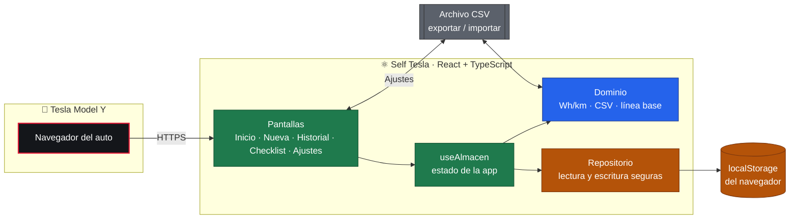
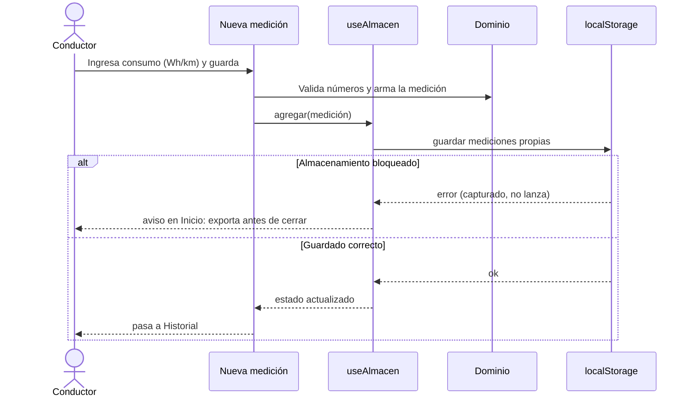
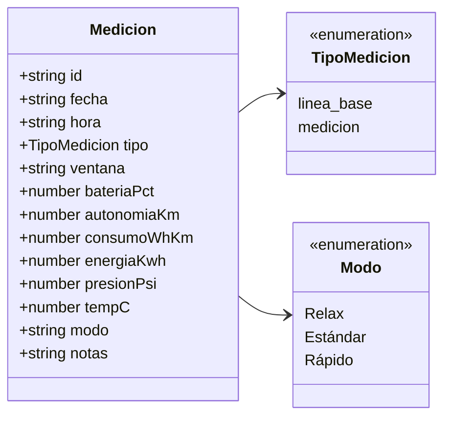
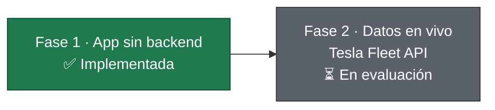

# Self Tesla · Consumo

Aplicación web para registrar, comparar y mejorar el consumo de un **Tesla Model Y RWD 2026 (LFP)**. Se abre en el navegador del propio auto.

[](https://github.com/Portfolio-jaime/self-tesla/actions/workflows/ci.yml)


---

## Tabla de contenido

1. [Qué hace](#qué-hace)
2. [Arquitectura](#arquitectura)
3. [Flujo: registrar una medición](#flujo-registrar-una-medición)
4. [Modelo de datos](#modelo-de-datos)
5. [Formato CSV](#formato-csv)
6. [Requisitos](#requisitos)
7. [Instalación y scripts](#instalación-y-scripts)
8. [Estructura del proyecto](#estructura-del-proyecto)
9. [CI/CD](#cicd)
10. [Uso en el Tesla](#uso-en-el-tesla)
11. [Hoja de ruta](#hoja-de-ruta)
12. [Contribuir](#contribuir)

---

## Qué hace

| Función | Descripción |
|:--|:--|
| 📊 **Registro** | Guarda cada medición: trayecto, consumo (Wh/km), batería, autonomía, presión, temperatura y modo de conducción. |
| 🔍 **Comparación** | Compara el trayecto de referencia (Casa-colegio) con la línea base del 1 de noviembre de 2026. |
| ✅ **Checklist** | Ocho puntos de configuración del auto (modo, regeneración, clima, llantas, carga LFP) con marcas guardadas. |
| ⚠️ **Alertas** | Avisa si la última presión registrada está por debajo de 42 psi. |
| 💾 **Exportar / importar** | Descarga y carga un CSV con el mismo formato de la línea base. |

> Sin backend: los datos se guardan **solo en el navegador** donde se usa la app. Nada se envía a un servidor.

---

## Arquitectura



**Leyenda:** 🟥 auto · 🟩 interfaz y estado · 🟦 lógica pura · 🟧 persistencia · ⬜ archivos

La regla de dependencias va en una sola dirección: las pantallas usan el hook, el hook usa el dominio y el repositorio, y el dominio **no conoce React ni el navegador**. Por eso sus cálculos se prueban con Vitest sin levantar nada.

---

## Flujo: registrar una medición



---

## Modelo de datos



Los campos numéricos pueden ser `null`: una medición de referencia puede no traer autonomía, por ejemplo.

---

## Formato CSV

Separador `;`, decimal `,` y cabecera fija. Es el mismo formato de la línea base:

```csv
Fecha;Hora;Tipo;Ventana o trayecto;Batería (%);Autonomía (km);Consumo (Wh/km);Energía (kWh);Presión (psi);Temp. (°C);Modo;Notas
01-nov;20:44;Línea base;Casa-colegio (126,5 km);47;;179,4;22,7;;22;Relax;Trayecto repetible
```

Al importar, las filas de **línea base no se duplican**: solo se agregan tus mediciones.

---

## Requisitos

- **Node.js 24** (fijado en [`.nvmrc`](.nvmrc))
- **npm** (viene con Node)
- *Opcional:* [direnv](https://direnv.net/) para cargar el entorno de la carpeta automáticamente

---

## Instalación y scripts

```bash
git clone https://github.com/Portfolio-jaime/self-tesla.git
cd self-tesla
nvm use          # Node 24, desde .nvmrc
npm ci
npm run dev      # http://localhost:5173
```

| Script | Qué hace |
|:--|:--|
| `npm run dev` | Servidor de desarrollo con recarga en caliente |
| `npm run test` | Pruebas unitarias con Vitest (21 pruebas) |
| `npm run lint` | Lint con oxlint |
| `npm run build` | Chequeo de tipos (`tsc -b`) y build de producción en `dist/` |
| `npm run preview` | Sirve el build de producción localmente |

### Variables de entorno

La app no necesita secretos en la fase actual. Si algún día los necesitas, van en `.env.local`, que está ignorado por Git. El [`.envrc`](.envrc) lo carga con direnv cuando existe.

---

## Estructura del proyecto

```
self-tesla/
├── .github/workflows/ci.yml     # CI: lint, test y build
├── public/favicon.svg
├── src/
│   ├── domain/                  # Lógica pura (sin React ni navegador)
│   │   ├── medicion.ts          #   tipo Medicion, modos, presión recomendada
│   │   ├── calculos.ts          #   Wh/km, diferencias, autonomía al 100 %
│   │   ├── csv.ts               #   parser y serializador del CSV
│   │   ├── lineaBase.ts         #   mediciones del 1 de noviembre de 2026
│   │   └── checklist.ts         #   los 8 puntos de configuración
│   ├── storage/repositorio.ts   # localStorage con try/catch
│   ├── hooks/useAlmacen.ts      # estado: línea base + mediciones propias
│   ├── pantallas/               # Inicio, NuevaMedicion, Historial, Checklist, Ajustes
│   ├── App.tsx                  # shell y navegación inferior
│   ├── index.css                # tema claro/oscuro con variables CSS
│   └── main.tsx
├── .envrc                       # direnv: cuenta gh personal, .env.local
├── .nvmrc                       # Node 24
├── .oxlintrc.json               # reglas de lint
├── vite.config.ts               # React + Vitest
└── tsconfig*.json
```

---

## CI/CD

```mermaid
flowchart LR
    DEV["👩‍💻 Desarrollador"] -->|push| BR["Rama de feature"]
    BR -->|Pull request| CI{{"GitHub Actions<br/>lint · test · build"}}
    CI -->|✅ pasa| REV["Revisión y merge"]
    REV -->|push a main| MAIN["main"]
    MAIN -->|CI otra vez| CI2{{"GitHub Actions"}}
    MAIN -->|Cloudflare Pages| CF["☁️ Build y deploy"]
    CF --> URL(["🌐 URL pública HTTPS"])
    URL --> CAR["🚗 Navegador del Tesla"]

    classDef dev fill:#14161a,stroke:#e31937,color:#ffffff
    classDef git fill:#24292f,stroke:#000000,color:#ffffff
    classDef ci fill:#2563eb,stroke:#1e3a8a,color:#ffffff
    classDef ok fill:#1f7a4d,stroke:#0f4d2e,color:#ffffff
    classDef cloud fill:#f38020,stroke:#9a4a00,color:#ffffff
    classDef car fill:#14161a,stroke:#e31937,color:#ffffff

    class DEV dev
    class BR,MAIN git
    class CI,CI2 ci
    class REV ok
    class CF cloud
    class URL ok
    class CAR car
```



- **CI** (`.github/workflows/ci.yml`): corre en cada pull request y en cada push a `main`. Ejecuta `npm ci`, `lint`, `test` y `build`. Las acciones usan Node 24.
- **CD**: Cloudflare Pages construye desde el repositorio conectado. Cada push a `main` se publica en producción.
- **Ramas**: la rama de una feature se borra automáticamente al mergear el PR.

### Configuración de Cloudflare Pages

| Campo | Valor |
|:--|:--|
| Framework preset | None |
| Build command | `npm run build` |
| Build output directory | `dist` |
| Versión de Node | La de `.nvmrc` (24) |

---

## Uso en el Tesla

1. Abre la URL pública en el **navegador del auto**.
2. Guárdala como favorito para tenerla a un toque.
3. Registra tus mediciones desde **Nueva**.

> ⚠️ El navegador del Tesla guarda los datos **en el propio auto**. No se comparten con tu computador ni con tu celular. Exporta el CSV desde **Ajustes** con regularidad para no perder nada.

---

## Hoja de ruta



- **Fase 1**: registro manual, comparación con línea base, checklist, exportar e importar.
- **Fase 2** (en evaluación): leer batería y energía desde la API oficial de Tesla. Requiere cuenta de desarrollador y una función serverless para el token.

---

## Contribuir

1. Crea una rama desde `main`: `feature/<nombre>` o `docs/<nombre>`.
2. Haz commits pequeños con [Conventional Commits](https://www.conventionalcommits.org/): `feat(...)`, `fix(...)`, `docs(...)`, `ci(...)`.
3. Abre un pull request. El CI debe pasar.
4. Al mergear, la rama se borra automáticamente.

---

*Hecho por Jaime Henao para su Model Y. Los datos de la línea base vienen de capturas del 1 de noviembre de 2026.*
